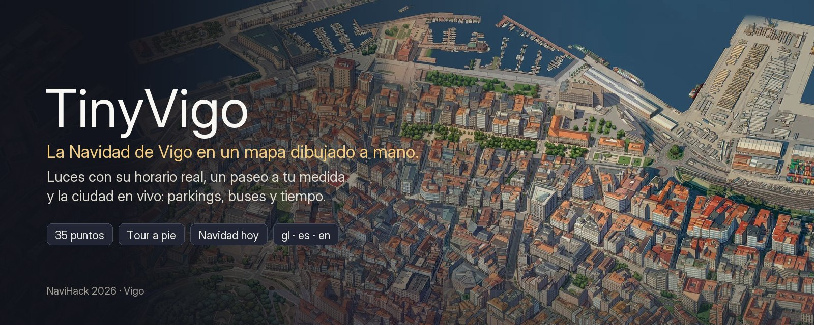
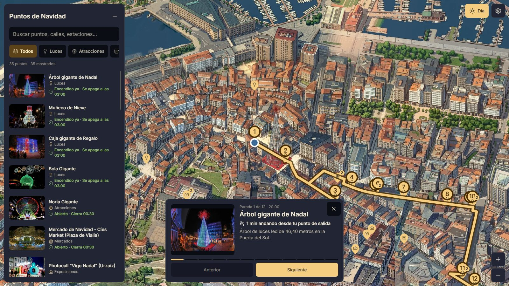
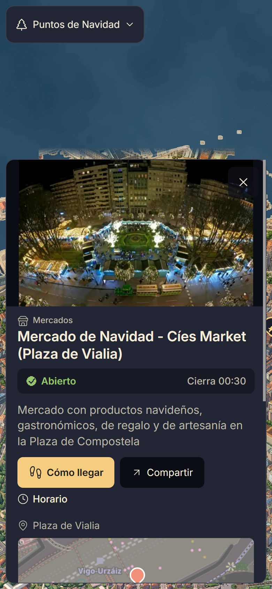
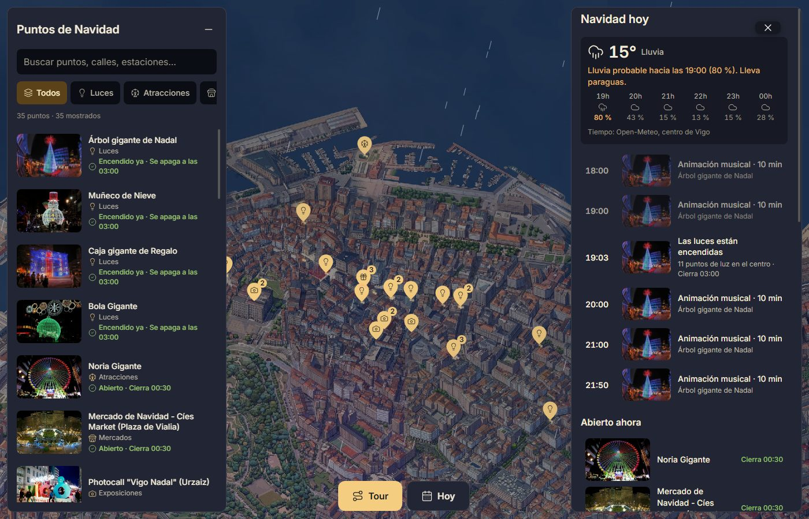
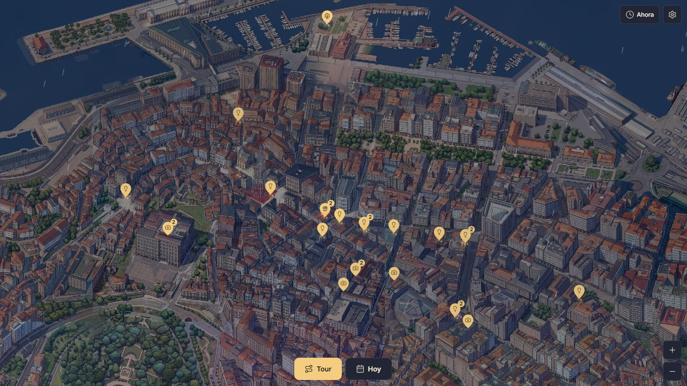
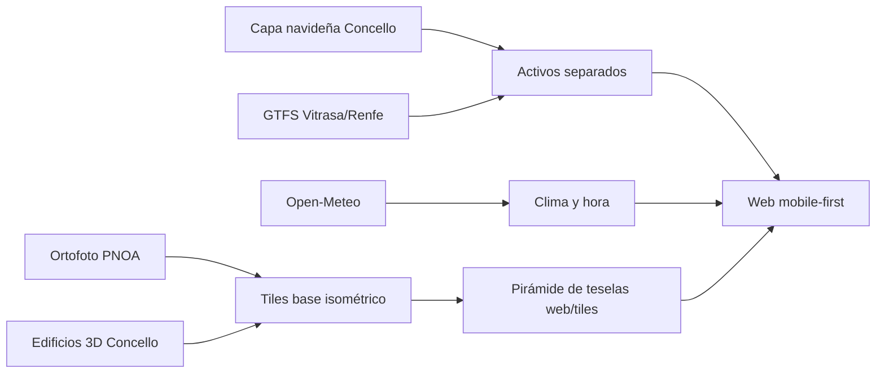

<p align="center">
  
</p>

<p align="center"><b>Web en vivo: <a href="https://navivigo.vercel.app">navivigo.vercel.app</a></b> · <a href="https://navivigo.vercel.app/demo/">probar la demo</a></p>

<p align="center">
  <a href="https://navivigo.vercel.app"><b>Web</b></a> ·
  <a href="https://navivigo.vercel.app/demo/"><b>Demo</b></a> ·
  <a href="#qué-hace-la-web">Qué hace</a> ·
  <a href="#arrancar-en-local">Arrancar</a> ·
  <a href="#equipo">Equipo</a>
</p>

<p align="center">
  
  
  
  
</p>

**TinyVigo** es la Navidad del centro de Vigo en un mapa isométrico pintado: los 35 puntos
del programa oficial con su horario real («Encendido ya», «Se apaga a las 03:00»), un paseo a
pie a la medida de tu tiempo que te cuenta parada a parada lo que vas a ver, y la ciudad en
vivo alrededor: parkings libres, buses, trenes y el tiempo. Hecho en un día para NaviHack 2026.

La landing está en [`landing/`](landing/); se publica con `landing/deploy.sh`, que copia `web/` como `demo/`.

**Para quién:** quien pasea por el centro con el móvil, sobre todo al caer la tarde, vecinos y
turistas, y quien tiene una o dos horas y quiere saber qué le cabe.

<p align="center">
  
</p>

## Equipo

| | |
|---|---|
| **Miguel Fernández de la Cigoña París** | [@miguelfdezparis](https://github.com/miguelfdezparis) |
| **Jose Estévez Saborido** | [@JoseEstevez520](https://github.com/JoseEstevez520) |
| **Alejandro Cancelas Chapela** | [@cacelass](https://github.com/cacelass) |

## Arrancar en local

```bash
make setup      # uv sync --extra dev + hooks de pre-commit
make website    # sirve web/ en http://127.0.0.1:8000 y abre el navegador
```

Alternativa sin `make` (Windows o entorno sin make):

```bash
uv run python -m scripts.serve_web --port 8000
# o, sin uv:
python -m scripts.serve_web --port 8000 --no-open
```

La web es estática pero hace `fetch()` de los tiles, por eso hace falta un
servidor: abrir `web/index.html` con doble clic (file://) no funciona.

Comprobaciones de salud del proyecto:

```bash
./init.sh            # puerta de entrada: ¿se puede trabajar?
make test            # pytest (proyecto + agentes)
make check           # lint + typecheck + test + arnés
```

## Qué hace la web

- **Mapa dibujado del centro y Vialia** (isométrico, OpenSeadragon) con los 35 puntos de Navidad
  del Concello: pin con icono por tipo, agrupados si se solapan.
- **Ficha de cada punto:** foto entera (en grande al tocarla), «Abierto · Cierra 00:30» o
  «Cerrado · Abre 18:00» calculado con el programa oficial 2026-27, horario, dirección con
  mini-mapa, parking más cercano con plazas libres en vivo y próximos buses programados.
- **Tour a pie:** «¿Cuánto tiempo tienes?» (30–120 min) y «¿Cuándo vas?» (ahora, 18:00, 20:00,
  22:00); elige lo que cabe y está abierto, lo enruta por calles reales y lo dibuja sobre el
  mapa; «Empezar el paseo» lo cuenta parada a parada. Lo lejano queda «para otro día».
- **Navidad hoy:** línea de tiempo con horas reales (encendido de luces, pases del Árbol,
  salidas), lo abierto ahora y lo navideño de la agenda del Concello, situado en el mapa.
- **Vista ciudad:** todo Vigo en OpenStreetMap con la foto de cada punto, los 12 parkings en
  vivo, estaciones y paradas (estas solo a nivel de calle) y la ruta desde casa.
- **Búsqueda** de puntos, eventos, estaciones y 1921 calles, sin tildes y con erratas.
- **Ajustes** en un solo botón: idioma (gl/es/en, por el navegador), vista, tema y créditos.
- **Compartir:** el enlace guarda el punto (`#p=...`) o el tour (`#tour=60-20`).
- **Seguimiento en ruta:** «Seguirme» sigue tu posición por el tour, pinta lo ya andado y dice
  «Te quedan 39 min · Próxima: …»; sin GPS, «Simular paseo».
- **Día, noche y clima:** la noche entra con la puesta de sol real y enciende las luces; lluvia,
  nubes y niebla según Open-Meteo, o a mano con el botón de hora y en Ajustes.
- **Historia** de cada punto con el texto del Concello, y la ficha con la foto en grande.

<p align="center"> </p>

<p align="center"></p>

El servidor de `make website` es `scripts/serve_web.mjs` (Node, sin dependencias): el
`http.server` de Python en Windows deja respuestas a medias con varias conexiones y la
primera carga podía quedar en blanco. `scripts/serve_web.py` lo usa si hay Node.

## El mapa (MAP-01)

El visor sirve la pirámide de teselas (`web/tiles/<version>/`) y añade encima
lo que cambia: marcadores de Navidad, eventos, buses, trenes, parkings, cámaras
y rutas. El panel de capas (icono de capas, arriba a la derecha) enciende y
apaga cada una; Navidad y Eventos vienen encendidas. El mini-mapa (arriba a la
derecha) enseña el lienzo entero con el rectángulo de lo que estás viendo y
sirve para moverte: tócalo o arrástralo. El interruptor «Foto real (PNOA)» del
mismo panel cambia al mapa real del IGN de la misma zona para orientarte.

Los niveles de zoom más gruesos se precargan en paralelo al arrancar, y los
datos del primer vistazo (`web/data/points.json`) van incrustados en
`web/index.html` para no añadir una petición más:

```bash
python -m scripts.bake_first_view   # reincrusta los puntos tras build_web_data
```

Medidas de rendimiento en el dispositivo real (no se envían a ningún sitio):
la consola del navegador deja `tinyvigoPerf.firstViewMs` (primer vistazo) y
`tinyvigoPerf.lastPanFps` (fps mientras se mueve el mapa):

```js
// consola del navegador
tinyvigoPerf
```

Los datos de ciudad (agenda, parkings, tiempo, recintos) salen de
`web/data/live/*.json`, publicados por `scripts/build_web_live.py`; el navegador
no llama a las APIs del Concello (WEB-05).

## Línea de comandos

El paquete `app` expone un CLI con `python -m app`. El subcomando principal es
`points`, que lee los puntos navideños de ``data/points.json`` y muestra un
resumen:

```bash
uv run python -m app points                          # texto en español
uv run python -m app points --lang gl                # en galego
uv run python -m app points --by-type                # conteo por tipo
uv run python -m app points --format json            # salida JSON
```

Ejemplo de salida:

```
Puntos navidenos de Vigo (35):
  concello-2552: Arbol gigante de Nadal (light)
  concello-2553: Muneco de Nieve (light)
  ...
```

## Arquitectura

```
  fuentes de datos (Concello, IGN, OSM, GTFS, Open-Meteo, ...)
            │
            ▼
  scripts/*  (snapshots versionados en data/raw/ + data/*.json)
            │
            ▼
  pipeline de render (isométrico, offline, una sola vez)
            │
            ▼
  web/tiles/*  +  web/js/*  (sitio estático)
            │
            ▼
  scripts/serve_web.py  →  navegador (mobile-first)
```

Dos tuberías conviven:

- **Datos → snapshots → web.** Cada fuente se descarga a `data/raw/` con su
  `fetched_at` y se normaliza a JSON en `data/`. La web consume esos JSON;
  nada se pide en vivo al usuario salvo el clima actual.
- **Render → tiles.** El mapa base se dibuja una sola vez (modelo de imagen) y
  se publica como pirámide de teselas en `web/tiles/`. Sol, sombras, noche y
  clima se aplican por código sobre esas teselas, no se redibujan.
  Cómo se hizo y qué se aprendió: [`pipeline/render/README.md`](pipeline/render/README.md) (manual) y
  [`docs/investigacion/expansion-vialia.md`](docs/investigacion/expansion-vialia.md) (memoria).

Diagrama del pipeline de render (Mermaid):



## Fuentes de datos

Tabla resumida; la auditoría completa (licencias, atribución y estado) está en
[`vault/01_PROYECTO/licencias.md`](vault/01_PROYECTO/licencias.md).

| Fuente | Licencia | Atribución |
|---|---|---|
| Concello — parkings, agenda, avisos, GTFS Vitrasa | ODC-BY 1.0 | Concello de Vigo — datos.vigo.org (ODC-BY) |
| Concello — capa navideña (ArcGIS) | No declarada (público) | Concello de Vigo — Puntos de interés de Navidad 2026-27 |
| Concello — Edificios 3D | No declarada | Concello de Vigo — Edificios 3D |
| Renfe GTFS AV/LD/MD | CC BY 4.0 | Renfe Operadora (CC BY 4.0) |
| Open-Meteo (forecast + marine) | CC BY 4.0 (API no comercial) | Weather data by Open-Meteo.com |
| IGN — PNOA ortofoto y LiDAR | CC BY 4.0 | PNOA cedido por © Instituto Geográfico Nacional |
| IGN/CNIG — MDT05 | CC BY 4.0 | MDT05 © Instituto Geográfico Nacional |
| OpenStreetMap | ODbL 1.0 | © OpenStreetMap contributors |
| Catastro (fallback de huellas) | Reutilización libre con atribución | Dirección General del Catastro |

Reglas duras: todo vehículo en movimiento se etiqueta «según horario», nunca
«en directo», mientras no haya un feed en vivo comprobado. Las fotos de la capa
navideña se enlazan con crédito; las propias (R-03) tienen prioridad.

## Cómo se trabaja aquí

Este repositorio usa un **arnés de desarrollo** que rige cómo trabaja un agente
de IA sobre él: puerta de entrada, backlog con criterios de aceptación, memoria
fuera de la ventana de contexto y puerta de permisos para las acciones que no
se deshacen. La fuente de verdad del backlog es **GEAS** (MongoDB); el fichero
local `harness/featureslist.json` es un espejo de solo lectura.

Reglas que se aplican a todo el mundo (humanos y agentes):

1. **Un actor por dispositivo.** Cada persona/máquina tiene su propio actor en
   GEAS (rol `agent`). No se comparte token entre cuentas.
2. **Claim antes de tocar.** Antes de modificar código se reclama el ticket con
   `harness start <ID>`: hace commit WIP, fetch, pull --rebase, push y
   `start_ticket` de forma atómica. Sin remoto configurado no hay claim.
3. **Una feature a la vez.** `harness next` dice qué toca; no se empieza otra
   sin cerrar la anterior.
4. **Evidencia, no afirmaciones.** Ninguna feature se marca `done` sin que
   `./init.sh` pase en verde y con la salida real del comando que prueba cada
   criterio.
5. **No se commitean marcadores de conflicto** (`<<<<<<<` / `>>>>>>>`): un
   `featureslist.json` con marcadores es JSON inválido y tumba la CI de todo el
   equipo.

Comandos habituales del arnés:

```bash
./init.sh                              # puerta de entrada
uv run python -m agents run harness next    # ¿qué toca?
uv run python -m agents run harness start --id DOC-01
uv run python -m agents run harness finish --id DOC-01 --evidence "..."
uv run python -m agents run git commit_feature --id DOC-01 --title "..." --dry-run true
```

El protocolo completo está en [`AGENTS.md`](AGENTS.md).

## Estado y roadmap

El estado vivo del trabajo está en [`harness/progress/current.md`](harness/progress/current.md)
y el histórico en [`harness/progress/history.md`](harness/progress/history.md). El
backlog con criterios de aceptación está en GEAS y se espeja en
[`harness/featureslist.json`](harness/featureslist.json).

Criterio de «hecho» del v1 (resumen; texto completo en
[`vault/01_PROYECTO/objetivo.md`](vault/01_PROYECTO/objetivo.md)):

- Mapa de la zona (4x4 o 5x5 teselas) dibujado y aceptado, 0 pendientes.
- 43 puntos de la capa navideña del Concello como activos separados con horario.
- Primer vistazo reconocible en < 3 s en móvil gama media con 4G.
- Planificador devuelve 3 opciones en < 2 s para hasta 12 paradas.
- Autobuses (Vitrasa) y trenes (Renfe) visibles y etiquetados «según horario».
- Clima de Open-Meteo y control de hora.
- Postal pixel art a partir de una foto propia.

Fuera de alcance del v1: área metropolitana, GPS real de buses, afluencia,
venta de entradas, cuentas, juegos, LoRA propia.

## Marca

<picture>
  <source media="(prefers-color-scheme: dark)" srcset="web/ui/assets/logo-blanco.svg">
  
</picture>

El árbol que se gira: dos capas y una luz en la punta. Del derecho es el árbol
de Porta do Sol; girado 180°, la falda es la V de Vigo. Guía completa (concepto,
versiones, paleta, tipografía y aplicaciones) en
[`web/ui/marca.html`](web/ui/marca.html).

## Licencia

Código bajo la licencia del repositorio (ver [`LICENSE`](LICENSE)). Los datos
tienen sus propias licencias (ver tabla de fuentes y `licencias.md`).

---

<p align="center">Hecho en Vigo por Miguel Fernández de la Cigoña París, Jose Estévez Saborido y Alejandro Cancelas Chapela · NaviHack 2026</p>
