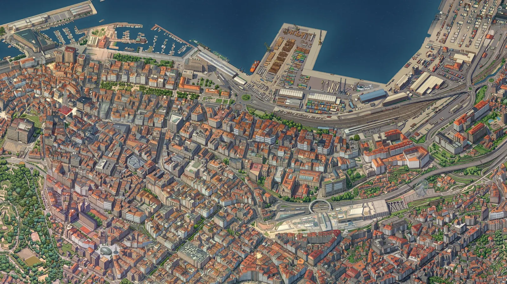
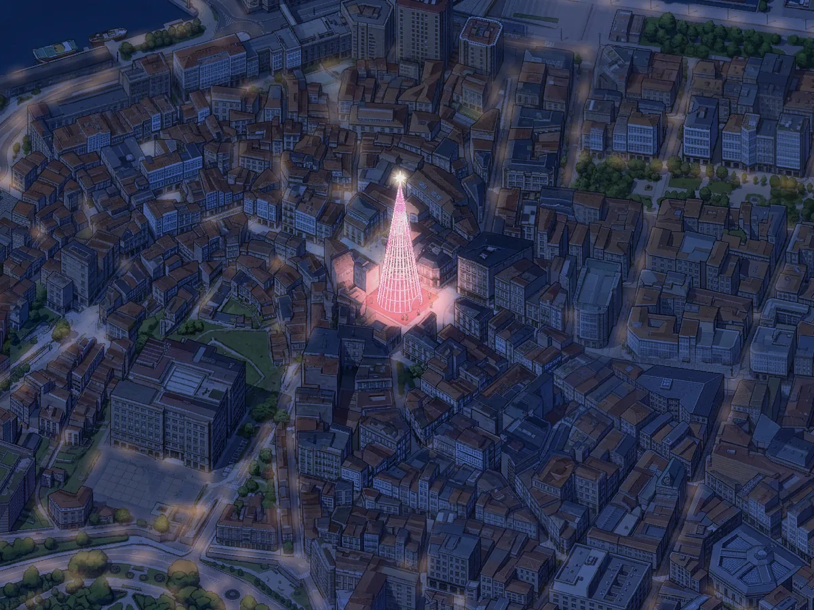
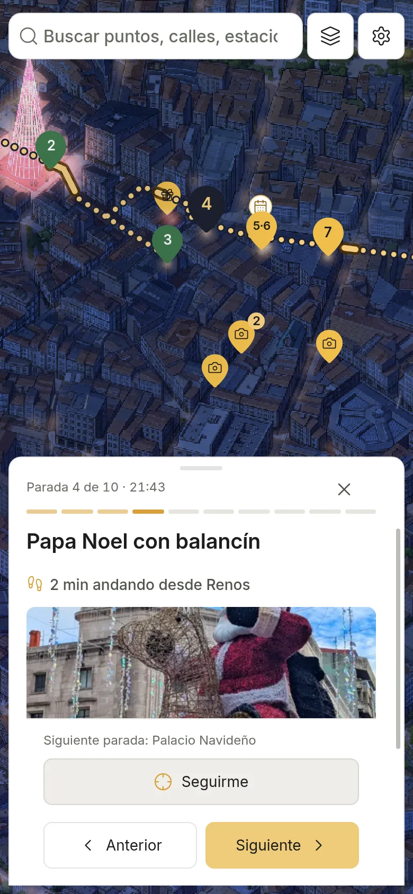
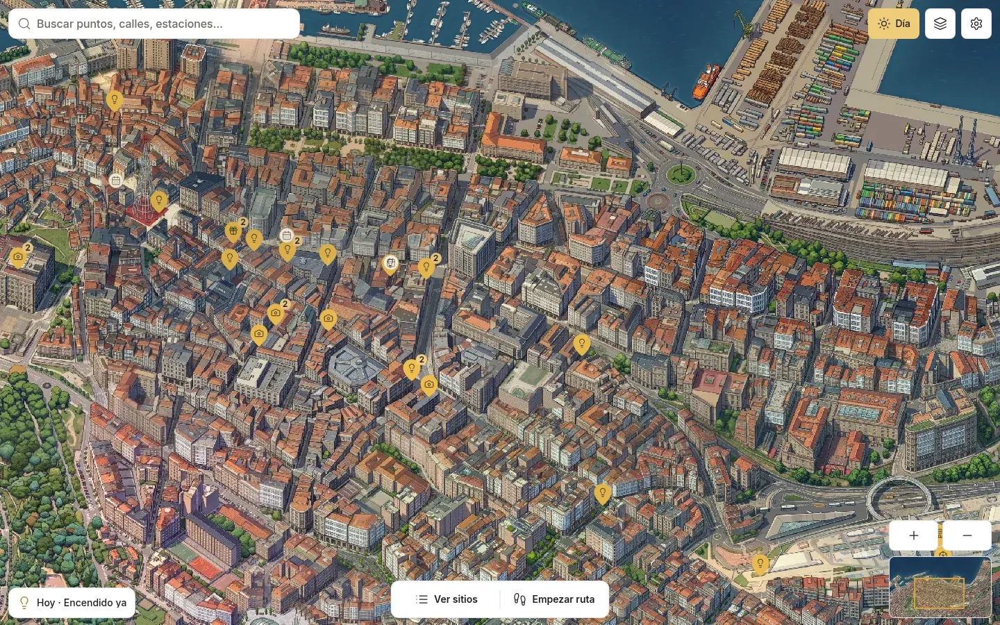

  

<b>Dosier comercial · 2026</b>

# NaviVigo

### La Navidad de Vigo, en un mapa que se recorre con el dedo.

**Para ayuntamientos, áreas de turismo, asociaciones de comercio, hoteles y marcas
que quieren una guía urbana diferencial sin construirla desde cero.**

NaviVigo es una plataforma web ya funcionando que convierte el centro de Vigo en un
mapa isométrico pixel art y lo cruza con la Navidad: 35 puntos oficiales, horarios,
rutas a pie, transporte, clima, postal y modo sin conexión. Se puede desplegar en su
dominio, adaptar a su ciudad o ceder como activo digital.

> **Resumen para el comprador.** No se compra un mapa: se compra una experiencia ya
> construida, con sus datos, su diseño, su motor de rutas y su documentación. El
> comprador evita meses de desarrollo y llega a la temporada con un producto que ya
> se puede enseñar.

**Web en vivo:** [navivigo.vercel.app](https://navivigo.vercel.app/) ·
**Demo:** [navivigo.vercel.app/demo](https://navivigo.vercel.app/demo/)

**Modalidades:** piloto de temporada · licencia por ciudad · compra del despliegue y la
marca · patrocinio · desarrollo a medida.

---

## Ficha para decidir

| Concepto | Detalle |
|---|---|
| **Qué es** | Plataforma web de guía urbana: mapa isométrico pixel art + capa de Navidad, rutas a pie, transporte, clima, postal y uso sin conexión |
| **Estado** | Demo funcional y publicada; lista para un piloto de temporada |
| **Cobertura** | Centro de Vigo y Vialia; ampliable a otra zona o ciudad |
| **Se entrega** | Despliegue web, teselas del mapa, fichas y datos, planificador, documentación y marca (según modalidad) |
| **No incluye** | Exclusividad sobre el código MIT, GPS real de buses, venta de entradas ni cuentas de usuario |
| **Plazo** | Un piloto de temporada puede prepararse en semanas, no en meses |
| **Web y demo** | [navivigo.vercel.app](https://navivigo.vercel.app/) · [demo](https://navivigo.vercel.app/demo/) |
| **Código** | [github.com/cacelass/NaviHack](https://github.com/cacelass/NaviHack) |
| **Contacto** | Alejandro Cancelas · [@cacelass](https://github.com/cacelass) |

  

---

## 1. El problema que resuelve

En Navidad, el centro de Vigo se llena de atracciones, luces y eventos. La información
existe, pero está repartida entre el programa del Concello, la agenda municipal, los
avisos, la prensa y los blogs. El visitante improvisa; el comercio pierde pasos; la
ciudad no tiene una capa digital única.

Y quien quiere resolverlo se enfrenta a construir varias cosas a la vez:

- Un mapa atractivo, con teselas, zoom y rendimiento móvil.
- Una capa de datos con horarios, fotos, direcciones y fuentes.
- Un planificador de rutas que respete lo que está abierto.
- Transporte, parkings, agenda y clima en la misma pantalla.
- Diseño, idiomas, accesibilidad, modo sin conexión y mantenimiento.

Eso son varios perfiles y meses de trabajo. **NaviVigo ya ha recorrido ese camino.**

| La pregunta del visitante | Lo que hay hoy | Lo que ofrece NaviVigo |
|---|---|---|
| ¿Qué está abierto ahora? | Cruzar el programa con la hora y el día | Cada punto con horario dice «Abierto · Cierra 01:00» o «Cerrado · Abre 18:00» |
| ¿Qué me cabe en 90 minutos? | Improvisar o copiar una lista | 3 rutas a pie con tus paradas, tu tiempo y los horarios de apertura |
| ¿Cómo llego sin coche? | Una web para el bus, otra para el tren, un mapa aparte | Buses y trenes sobre el mismo mapa, con horario programado |
| ¿Qué es esto? | Una foto y un pie de foto | Ficha con historia, foto, dirección, parking y cómo llegar |
| ¿Y el recuerdo? | Una foto en el carrete | Postal pixel art con el mapa y la foto del visitante |
| ¿Y si no hay cobertura? | Nada | El mapa guardado sigue funcionando sin conexión |

---

## 2. El activo: cuatro capas que se pueden comprar juntas o por separado

NaviVigo no es solo una web. Es un activo digital con cuatro capas:

### Marca y experiencia

El nombre, el árbol que, girado 180°, forma la V de Vigo, la paleta, la tipografía y el
sistema visual. Una marca reconocible para una guía de ciudad, con aplicación en web,
cartelería, QR y postal.

### Producto

La web completa: mapa isométrico, fichas, planificador de rutas, capas de ciudad,
búsqueda, enlace compartible, seguimiento del paseo y modo sin conexión. Funciona sin
instalar nada y sin cuentas.

### Datos y contenido

Los 35 puntos de la capa oficial 2026-27, con foto, dirección, historia y horario cuando
el Concello lo publica. Además: 1.921 calles, 555 paradas de bus, 7 servicios de tren,
12 parkings en vivo y la agenda del día con el encendido, los pases del Árbol, el Nadal
Bus, el barco y el tiempo hora a hora.

### Método y documentación

La tubería que convierte datos abiertos en teselas, fichas y capas; los scripts de
actualización; la auditoría de licencias; la puerta de calidad y la documentación para
que otro equipo pueda mantenerlo.

---

## 3. Qué recibe exactamente

La entrega se adapta a la modalidad, pero un despliegue completo incluye:

| Bloque | Contenido |
|---|---|
| **Despliegue web** | Sitio estático en su dominio o subdominio, responsive, en gallego, castellano, inglés y portugués |
| **Mapa** | 84 teselas WebP en 5 niveles de zoom, mini-mapa, vista ciudad con satélite y panel de 8 capas |
| **Contenido** | 35 fichas de Navidad con foto, historia, dirección y horario; fuentes y atribuciones |
| **Producto** | Planificador de 3 rutas de 15 min a 4 h, capas, búsqueda, enlace compartible y seguimiento del paseo |
| **Sin conexión** | PWA con guardado del mapa completo (unas 10 MB) para caminar sin cobertura |
| **Datos** | Snapshots versionados y scripts de actualización de agenda, parkings y clima |
| **Documentación** | README, spec del producto, auditoría de licencias y documentación de datos |
| **Marca** | Activos de NaviVigo para co-branding o cesión, según la modalidad |
| **Soporte** | Ventana de soporte y actualizaciones durante la temporada, a acordar |
| **Opcional** | Postal con modelo de imagen, QR en puntos físicos, nueva ciudad, nuevas capas |

**Qué no incluye** (salvo acuerdo expreso):

- Exclusividad sobre el código: es MIT y ya está publicado.
- Posiciones GPS reales de los buses de Vitrasa: no se publican; se usa horario.
- Venta de entradas, reservas, cuentas de usuario o datos personales.
- Datos o mapa fuera de la zona acordada.
- Costes de terceros: hosting, dominio, modelo de imagen de la postal.
- Asesoramiento legal sobre licencias de datos; se entrega la auditoría y la atribución.

  

---

## 4. Qué puede hacer su organización con NaviVigo

| Comprador | Qué despliega | Qué obtiene |
|---|---|---|
| **Ayuntamiento o área de turismo** | La guía digital de su Navidad, con sus datos y su marca | Una capa digital sobre datos propios, sin desarrollar una app; QR en los puntos (opcional); medición agregada del uso (si se acuerda) |
| **Asociación de comercio o centro comercial** | Una capa patrocinada, una ruta o la postal | Presencia útil en el paseo del visitante; una ruta que pasa por el comercio; un recuerdo que se comparte |
| **Hotel, apartamento turístico u operador** | Una guía para huéspedes con rutas y postal | Un servicio diferencial sin mantener tecnología; enlace propio; imagen de marca |
| **Otra ciudad o destino** | La misma plataforma con su mapa y sus datos | Llegar a la temporada con un calendario acordado; reutilizar una tubería probada; coste menor que construirlo |
| **Marca o patrocinador** | La capa de Navidad, una ruta o la postal | Visibilidad dentro de una experiencia útil, no un banner; contenido compartible |

---

## 5. La prueba: qué está construido

| Función | Qué hace |
|---|---|
| **Mapa isométrico** | 84 teselas, 5 niveles de zoom, mini-mapa, vista ciudad con satélite, panel de 8 capas y PNOA real |
| **35 puntos de Navidad** | 31 en el mapa y 4 en la vista ciudad; foto, historia, dirección y horario |
| **Rutas a pie** | 3 opciones deterministas, de 15 min a 4 h, horarios de apertura y «para otro día» |
| **Transporte** | 555 paradas y 3.743 viajes de Vitrasa; 7 servicios de Renfe; horario programado |
| **Parkings en vivo** | 12 parkings con plazas libres, actualizados cada dos minutos |
| **Agenda del día** | Encendido, pases del Árbol, Nadal Bus, barco y tiempo de Vigo hora a hora |
| **Tiempo y luz** | Open-Meteo, salida y puesta de sol, noche, lluvia, nubes y niebla |
| **Búsqueda** | 1.921 calles, puntos, eventos y estaciones; sin tildes y con erratas |
| **Estado compartible** | Punto, ruta y hora viven en la URL |
| **Cuatro idiomas** | Gallego, castellano, inglés y portugués, según el navegador |
| **Seguimiento en ruta** | «Seguirme» con metros y próxima parada; GPS real o «Simular paseo» |
| **Sin conexión** | PWA: guarda el mapa completo (unas 10 MB) y sigue funcionando sin cobertura |
| **Postal** | Prototipo navegable con foto, lugar, mensaje y descarga en PNG |

Las cifras son de la versión publicada (noviembre de 2026). La capa oficial 2026-27
tiene 35 puntos; el «43» de materiales anteriores era la previsión de la edición
2025-26.

  

### Demo para la reunión (60 segundos)

| Tiempo | Qué hace | Qué se ve | Qué decir |
|---|---|---|---|
| **0:00** | Abre la demo | El centro de Vigo de noche, con las luces | «Esto no es una foto: es Vigo dibujado tesela a tesela» |
| **0:10** | Toca el árbol de Porta do Sol | Ficha con foto, «Abierto · Cierra 01:00», historia, parking y cómo llegar | «Sabe qué está encendido y qué hay alrededor» |
| **0:25** | «¿Cuánto tiempo tienes? 60 min · ahora» | Tres rutas, parada a parada, con lo que queda «para otro día» | «No enseña 35 puntos: dice cuáles caben» |
| **0:40** | Cambia la hora a las 22:00 y activa lluvia | El mapa se enciende; cambian la luz y el clima | «La misma ciudad, a la hora a la que va a pasear» |
| **0:52** | Abre Ajustes y señala «Guardar el mapa» | «Guarda el mapa para usarlo sin cobertura (unas 10 MB)» | «Sirve también cuando la red se cae» |
| **0:58** | Cierra | — | «NaviVigo: la Navidad de Vigo, con hora y camino» |

---

## 6. Por qué comprar hecho y no construirlo

| Construirlo desde cero | Comprar NaviVigo |
|---|---|
| Varios perfiles: mapa, datos, frontend, contenido, diseño | Un equipo que ya ha recorrido el camino |
| Meses hasta la primera versión presentable | Un piloto de temporada en semanas |
| Riesgo en licencias de datos y atribución | Auditoría de licencias incluida |
| Render del mapa, teselas, costuras y estilo | 84 teselas ya dibujadas y publicadas |
| Planificador, capas, accesibilidad, idiomas y offline | Producto funcionando y documentado |
| Mantenimiento y soporte desde el día uno | Soporte y evolución a acordar |

El código es abierto (MIT): su equipo técnico puede auditarlo, ejecutarlo y comprobar
que no hay caja negra. Lo que se compra no es el código en sí, sino **el despliegue, la
marca, el contenido, los datos curados y el tiempo ahorrado**.

---

## 7. Modalidades de operación

| Modalidad | Qué es | Qué recibe el comprador | Ideal para |
|---|---|---|---|
| **Piloto de temporada** | Despliegue de NaviVigo para una temporada, con soporte | Web en su dominio, datos de la zona, marca compartida y medición | Ayuntamiento, turismo o centro comercial que quiere probar |
| **Licencia por ciudad** | La plataforma adaptada a otra ciudad o destino | Mapa y datos de su ciudad, despliegue, marca y soporte | Otra ciudad que quiere su propia guía |
| **Compra del despliegue y la marca** | Cesión del despliegue canónico de Vigo y de la marca NaviVigo | Presencia web (el dominio que se acuerde), activos gráficos, contenido, documentación y transición | Comprador que quiere quedarse con el activo y operarlo |
| **Patrocinio** | Una marca financia una capa, una ruta o la postal | Presencia integrada en la experiencia y contenido compartible | Marca que busca visibilidad útil |
| **Desarrollo a medida** | Nuevas capas, idiomas, postal o funcionalidades | Alcance cerrado y entrega por hitos | Comprador con requisitos propios |

La **cesión en exclusiva de la marca NaviVigo es única**: solo puede venderse una vez.
La licencia de la plataforma puede convivir con otros despliegues en otras ciudades.

---

## 8. Propiedad intelectual y licencias

Es importante que su equipo legal lo sepa antes de negociar:

- **Código:** MIT. Ya está publicado y puede ser inspeccionado, copiado y modificado por
  cualquiera. No se puede «cerrar» retroactivamente.
- **Marca y activos gráficos propios:** titularidad del equipo; se licencian o ceden
  según la modalidad.
- **Datos de terceros:** conservan sus licencias (Concello, IGN, OpenStreetMap, Renfe,
  Open-Meteo, Catastro). La entrega incluye la atribución y la auditoría; el comprador
  debe cumplirlas.
- **Lo que puede ser exclusivo:** la marca, la exclusividad comercial del despliegue,
  el contenido curado y el soporte. **Lo que no:** el código MIT ya publicado.
- Si su organización necesita una versión propietaria, se puede explorar una
  reimplementación sobre una base nueva; el código ya publicado seguirá siendo MIT.

La auditoría completa está en [`vault/01_PROYECTO/licencias.md`](../vault/01_PROYECTO/licencias.md).

---

## 9. Propuesta económica

La propuesta se estructura por alcance, no por usuario ni por visita. El producto es
estático y se sirve desde cualquier hosting; no hay licencia por usuario ni por visita.
El hosting y el dominio son costes de infraestructura: se pueden incluir en la cuota o
contratarse aparte.

| Concepto | Qué cubre | Forma |
|---|---|---|
| **Implantación** | Adaptación de datos, mapa, contenido, despliegue y QA | Pago único al inicio |
| **Temporada** | Hosting, soporte, actualizaciones y pequeñas evoluciones | Cuota por temporada o anual |
| **Personalización** | Marca, capas, idiomas, QR, postal u otras funciones | Por alcance |
| **Consumo de postal** | Modelo de imagen por postal, con topes | Variable, con tope mensual |

Los importes se fijan después de la demo y del alcance. No hay coste por usuario ni
licencia por asiento; el hosting y el dominio son costes de infraestructura.

Si necesita una horquilla antes de la reunión, se puede enviar una estimación no
vinculante con el alcance mínimo.

---

## 10. Plan de implantación

| Fase | Qué pasa | Resultado |
|---|---|---|
| **0. Alcance** | Reunión, objetivos, datos disponibles, marca y KPIs | Propuesta cerrada y calendario |
| **1. Adaptación** | Datos, mapa, contenido, configuración y despliegue | Entorno de pruebas navegable |
| **2. Piloto** | Lanzamiento, soporte y medición durante la temporada | Producto en uso y datos de decisión |
| **3. Renovación** | Nuevas capas, nueva temporada u otra ciudad | Continuidad o expansión |

El calendario es orientativo y se confirma tras el alcance. Un piloto de temporada se
prepara en semanas; una ciudad nueva depende de sus datos y de su mapa.

---

## 11. Riesgos y cómo se mitigan

| Riesgo | Mitigación |
|---|---|
| **Datos oficiales incompletos o que cambian** | Snapshots con fecha, overrides y revisión; lo que no está confirmado se dice |
| **Licencias de datos** | Auditoría, atribución y sustitución de fuentes si es necesario |
| **Dependencia de APIs públicas** | Datos estáticos, aproximación declarada y alternativas 2D si falla la vista satélite |
| **Estacionalidad** | Licencia por temporada, otras capas estacionales y otras ciudades |
| **Continuidad del equipo** | Documentación, código MIT y contrato de soporte; otro equipo puede mantenerlo |
| **Rendimiento en móviles** | Presupuesto medido, capas perezosas y vista 2D de respaldo |
| **Privacidad** | Sin cuentas ni rastreadores; preferencias en el navegador; métricas agregadas si se acuerdan |

---

## 12. Equipo y continuidad

| Persona | GitHub |
|---|---|
| **Miguel Fernández de la Cigoña París** | [@miguelfdezparis](https://github.com/miguelfdezparis) |
| **Jose Estévez Saborido** | [@JoseEstevez520](https://github.com/JoseEstevez520) |
| **Alejandro Cancelas Chapela** | [@cacelass](https://github.com/cacelass) |

El equipo ha construido el mapa, la tubería de datos, el planificador y la web. La
primera versión se presentó en **1Hack 2026** (A Coruña, 14 de noviembre de 2026); el
repositorio incluye la evolución posterior, con CI, tests, documentación y una puerta
de calidad (`./init.sh`). El repositorio conserva el nombre `NaviHack`; el producto se
llama NaviVigo.

La continuidad no depende de una sola persona: el código es MIT, está documentado y
puede ser mantenido por otro equipo. Si el comprador quiere, el equipo se mantiene para
evolucionar el producto.

---

## 13. Siguiente paso

1. **Demo de 30 minutos.** Se enseña el producto, se ajusta al caso del comprador y se
   resuelven dudas técnicas y de licencias.
2. **Alcance y propuesta.** En una semana, con objetivos, entregables, calendario e
   importes.
3. **Piloto.** Despliegue, lanzamiento y medición durante la temporada.

Para preparar la demo, indique:

- Ciudad o destino y temporada.
- Si tiene datos oficiales (agenda, puntos, transporte) y quién los publica.
- Si quiere marca propia, co-branding o la marca NaviVigo.
- Qué quiere medir y qué fecha objetivo tiene.

**Contacto:** Alejandro Cancelas · [@cacelass](https://github.com/cacelass) ·
[github.com/cacelass/NaviHack](https://github.com/cacelass/NaviHack)

---

## Anexo: ficha técnica

| Campo | Detalle |
|---|---|
| **Frontend** | HTML, CSS y JavaScript sin framework; OpenSeadragon, Leaflet y MapLibre GL para la vista ciudad |
| **Datos** | Python para descarga, normalización y build; snapshots versionados |
| **Mapa** | 84 teselas WebP en 5 niveles de zoom; render offline; PNOA para la foto real |
| **Rutas** | Planificador determinista; matriz a pie con OSRM y aproximación si falla |
| **Tiempo** | Open-Meteo; sol, noche y clima por código |
| **Sin conexión** | Service worker y PWA; guardado completo del mapa (unas 10 MB) |
| **Hosting** | Sitio estático; Vercel o cualquier CDN/hosting estático |
| **Idiomas** | Gallego, castellano, inglés y portugués |
| **Código** | MIT |
| **Calidad** | CI, tests, lint, typecheck y `./init.sh` |
| **Documentación** | [`README.md`](../README.md), [`docs/tinyvigo-spec.md`](tinyvigo-spec.md) |

## Anexo: fuentes y licencias

| Fuente | Uso | Licencia |
|---|---|---|
| Concello de Vigo — datos abiertos y GTFS | Parkings, agenda, avisos, bus | ODC-BY 1.0 |
| Concello de Vigo — capa de Navidad y edificios 3D | Puntos y geometría | No declarada (público) |
| Renfe — GTFS | Trenes | CC BY 4.0 |
| Open-Meteo | Tiempo | CC BY 4.0 (API no comercial) |
| IGN — PNOA y MDT05 | Ortofoto y elevación | CC BY 4.0 |
| OpenStreetMap | Calles, lugares y rutas | ODbL 1.0 |
| Catastro | Huellas de edificios | Reutilización libre con atribución |

NaviVigo es un proyecto independiente: **no es una web oficial del Concello de Vigo**.
Los datos conservan sus licencias y su atribución.

---

<i>NaviVigo · Vigo, noviembre de 2026</i>

