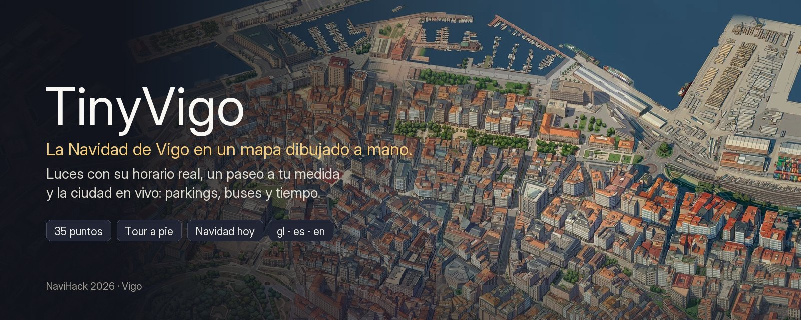
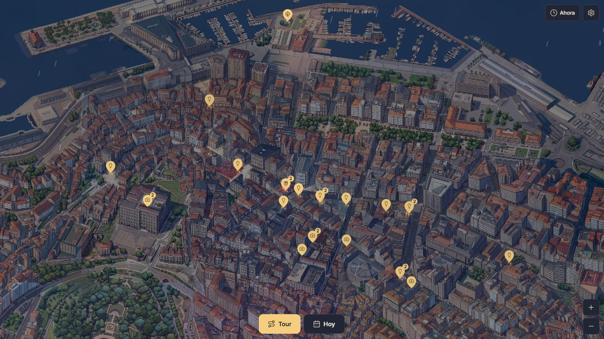
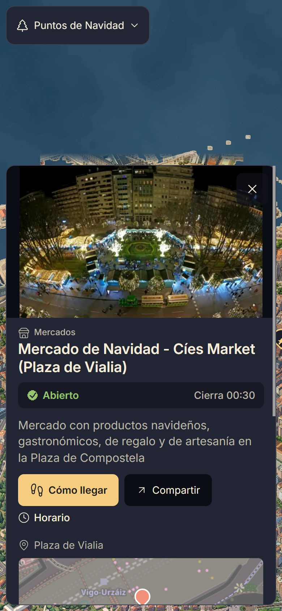
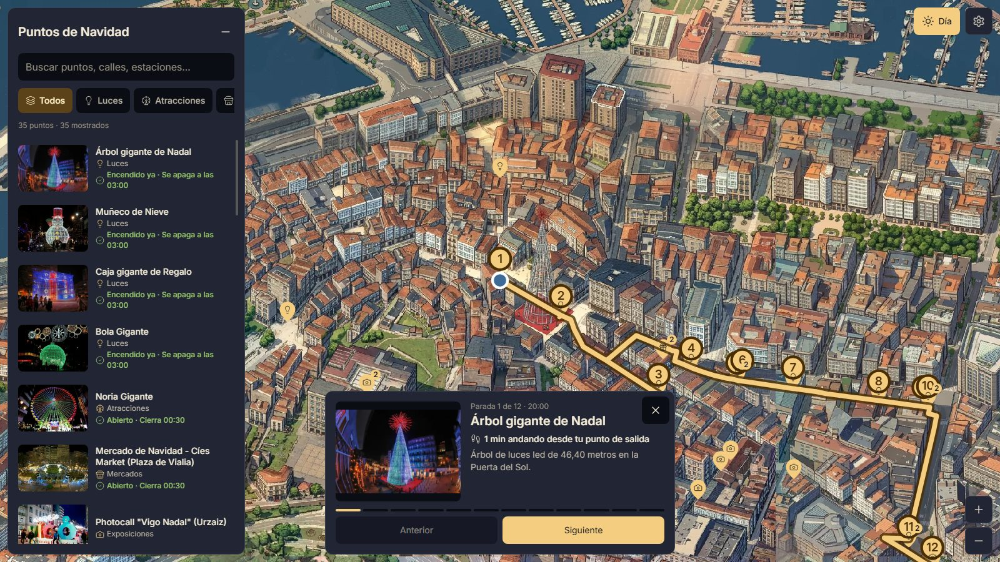

> **Uso interno.** Este es el pitch de hackathon (marca TinyVigo). Para enviar a
> compradores, usa el [dosier comercial NaviVigo](dossier-comercial-navivigo.md).

<p align="center">
  
</p>

<p align="center"><b>La Navidad de Vigo, en un mapa que se recorre con el dedo.</b></p>

# TinyVigo

**El mapa que sabe qué está encendido.**

TinyVigo convierte el centro de Vigo en un mapa isométrico pixel art navegable y le pone
encima la Navidad: los 35 puntos oficiales con su historia y su horario cuando el Concello lo
publica, rutas a pie que respetan lo que está abierto, buses y trenes, el tiempo y la luz de
la hora a la que vas a pasear.

Sin instalar nada. Sin cuentas. Con una mano y a la intemperie.

> **En una frase.** No es un mapa con chinchetas: es una guía temporal. Responde a «¿qué
> está encendido ahora?», «¿qué me cabe en 90 minutos?» y «¿cómo llego andando?» en la misma
> pantalla.

---

## Ficha rápida

| Campo | Detalle |
|---|---|
| **Qué es** | Mapa isométrico pixel art del centro de Vigo + capa de Navidad, rutas a pie, transporte, clima y postal |
| **Para quién** | Quien pasea por el centro con el móvil: vecinos y turistas, sobre todo al caer la tarde |
| **Estado** | Demo funcional (local) construida para NaviHack 2026; postal pixel art en prototipo |
| **Código** | MIT · HTML/CSS/JS sin framework · Python para datos y build |
| **Datos** | Concello de Vigo, IGN, OpenStreetMap, Catastro, Renfe, Open-Meteo |
| **Demo** | `make setup && make website` → `http://127.0.0.1:8000` |
| **Repo** | [github.com/cacelass/NaviHack](https://github.com/cacelass/NaviHack) |

<p align="center">
  
</p>

---

## 1. El problema

En Navidad el centro de Vigo se llena de atracciones, luces y eventos. También se llena de
las mismas preguntas:

- **¿Qué está abierto ahora?** El programa oficial da horarios, pero hay que cruzarlos con
  el día y la hora.
- **¿Qué me cabe?** Con una o dos horas, elegir mal significa pasear de más y ver de menos.
- **¿Cómo llego?** El bus, el tren, el parking y el mapa suelen vivir en sitios distintos.
- **¿Qué es esto?** Una foto y un pie de foto no cuentan por qué ese sitio está ahí.

La información existe. Está repartida en el programa del Concello, la agenda municipal, los
avisos, la prensa y los blogs. **Lo que falta no es un mapa más: es una capa que cruce esos
datos con tu tiempo y tu posición.**

Y el problema se mueve cada año: en esta edición la noria y el Cíes Market se han trasladado
a Vialia. Hasta el mapa oficial cambia.

| La pregunta | Lo que hay hoy | Lo que hace TinyVigo |
|---|---|---|
| ¿Qué está abierto ahora? | Cruzar el programa con la hora y el día | Cada punto con horario dice «Abierto · Cierra 01:00» o «Cerrado · Abre 18:00» |
| ¿Qué me cabe en 90 minutos? | Improvisar o copiar una lista | 3 rutas a pie con tus paradas, tu tiempo y los horarios de apertura |
| ¿Cómo llego sin coche? | Una web para el bus, otra para el tren, un mapa aparte | Buses y trenes sobre el mismo mapa, con horario y la etiqueta «según horario» |
| ¿Qué es esto? | Una foto y un pie de foto | Ficha con historia, foto, dirección, parking y cómo llegar |
| ¿Y el recuerdo? | Una foto en el carrete | Postal pixel art con el mapa y tu foto (prototipo) |

---

## 2. La solución

TinyVigo tiene cinco ideas, y ninguna sobra:

### Un mapa dibujado, no una foto de Google

El centro de Vigo y Vialia están dibujados tesela a tesela, en isométrico 2:1, con la familia
visual de `tiny.london` o `isometric.nyc`. Son **65 teselas WebP en 4 niveles de zoom (4,2
MB)**: se descarga solo lo que cabe en pantalla y el primer vistazo no espera a un modelo.

El interruptor **«Foto real (PNOA)»** enseña la ortofoto del IGN de la misma zona para
orientarse. El mapa dibujado es el escaparate; la foto real, la prueba.

### La Navidad como capa de datos, no como decoración

Los **35 puntos de la capa oficial 2026-27** van como activos separados, nunca pintados en el
mapa base: 30 sobre el mapa dibujado y 5 en la vista de ciudad. Cada uno tiene foto, dirección,
historia y, cuando el Concello lo publica, horario real.

La ficha no dice «abierto» a secas: dice **«Abierto · Cierra 01:00»** o **«Cerrado · Abre
18:00»**, calculado con el programa oficial y sus excepciones (24 y 31 de diciembre, días de
apertura especial, noches que se alargan hasta el amanecer).

<p align="center">
  
</p>

### El tiempo como variable de primera clase

No se elige «una lista de 35 sitios». Se elige **cuánto tiempo tienes** (30–120 minutos) y
**cuándo vas** (ahora, 18:00, 20:00, 22:00). El planificador devuelve **3 opciones**:

- **La más rápida**, con menos minutos andando.
- **La de después de anochecer**, que prefiere los tramos con luces encendidas.
- **La de paseo fácil**, que evita cuestas.

El orden es óptimo y determinista: la misma entrada da siempre las mismas 3 rutas. Lo que
queda lejos de tu recorrido aparece en **«para otro día»**, y lo que está cerrado a esa hora
se dice: **«Cerrado a esa hora»**.

<p align="center">
  
</p>

### La ciudad real alrededor

Sobre el mapa conviven **7 capas**: Navidad, eventos del día, buses, trenes, parkings,
cámaras y rutas. La agenda municipal se sitúa en el mapa; los parkings enseñan plazas libres;
los trenes y buses llevan su horario y se etiquetan **«según horario»**, nunca «en directo»
mientras no exista un feed en vivo comprobado.

Y el cielo: la noche entra con la puesta de sol real, las luces se encienden a su hora y la
lluvia, las nubes y la niebla salen de Open-Meteo. Se puede mover la hora a mano para ver la
ciudad a la hora a la que vas a pasear.

### El recuerdo

El prototipo de **postal pixel art** convierte una foto propia en una postal de un punto de
Vigo. El marco, el título, el mensaje, el sello y el matasellos los pone el código; el modelo
de imagen solo coloca a la persona en la escena. La interfaz y la composición ya están:
`web/ui/postal.html`.

---

## 3. Demo en 60 segundos

| Tiempo | Qué haces | Qué se ve | Qué decir |
|---|---|---|---|
| **0:00** | Abre la demo en el móvil | El centro de Vigo de noche, con las luces | «Esto no es una foto: es Vigo dibujado tesela a tesela» |
| **0:10** | Toca el árbol de Porta do Sol | Ficha con foto, «Abierto · Cierra 01:00», historia, parking y cómo llegar | «Sabe qué está encendido y qué hay alrededor» |
| **0:25** | «¿Cuánto tiempo tienes? 60 min · ahora» | Tres rutas, parada a parada, con lo que queda «para otro día» | «No te enseña 35 puntos: te dice cuáles te caben» |
| **0:40** | Cambia la hora a las 22:00 y activa lluvia | El mapa se enciende; cambian la luz y el clima | «La misma ciudad, a la hora a la que vas a pasear» |
| **0:52** | Copia el enlace y ábrelo en otra pestaña | Mismo punto, misma ruta, misma hora | «El estado viaja en la URL. Sin cuentas» |
| **0:58** | Cierra | — | «TinyVigo: la Navidad de Vigo, con hora y camino» |

Para arrancarla en local:

```bash
make setup      # uv sync --extra dev + hooks
make website    # http://127.0.0.1:8000
```

La web es estática pero hace `fetch()` de las teselas y los datos: hace falta servirla, no
vale abrir `web/index.html` con doble clic.

---

## 4. Lo que ya está construido

| Función | Qué hace | Dónde está |
|---|---|---|
| **Mapa isométrico** | 65 teselas, 4 niveles de zoom, mini-mapa, vista ciudad, panel de 7 capas y PNOA real | `web/tiles/v7-puerto-vialia/`, `web/js/layers.js` |
| **35 puntos de Navidad** | 30 en el mapa y 5 en la vista de ciudad; foto, historia, dirección y horario | `web/data/points.json` |
| **Rutas a pie** | 3 opciones deterministas, 30–120 min, horarios de apertura y «para otro día» | `web/js/planner.js` |
| **Transporte** | 557 paradas y 3.670 viajes de Vitrasa; 7 servicios de Renfe; etiqueta «según horario» | `web/data/transit.json` |
| **Parkings en vivo** | 12 parkings con plazas libres y enlace al punto más cercano | `web/data/live/parkings.json` |
| **Agenda del día** | Eventos del Concello situados en el mapa y enlazados a su ficha | `web/data/live/agenda.json` |
| **Tiempo y luz** | Open-Meteo, salida y puesta de sol, noche, lluvia, nubes y niebla | `web/js/ambient.js` |
| **Búsqueda** | 1.921 calles, puntos, eventos y estaciones; sin tildes y con erratas | `web/js/search.js`, `web/data/streets.json` |
| **Estado compartible** | Punto, ruta y hora viven en la URL | `web/js/share.js` |
| **Tres idiomas** | Gallego, castellano e inglés, según el navegador | `web/data/i18n/` |
| **Seguimiento en ruta** | GPS real o «Simular paseo»; pinta lo andado y dice cuánto queda | `web/js/track.js` |
| **Postal** | Prototipo navegable con foto, lugar, mensaje y descarga en PNG | `web/ui/postal.html` |

El rendimiento no se promete: se mide. La consola del navegador deja
`tinyvigoPerf.firstViewMs` (primer vistazo) y `tinyvigoPerf.lastPanFps` (fluidez al mover el
mapa). En un móvil de gama media con 4G, el presupuesto es **< 3 s para el primer vistazo** y
**≥ 30 fps** con las capas por defecto; el planificador, **< 2 s para 12 paradas**.

Las cifras son de los snapshots versionados en `data/` y `web/data/` (14/11/2026). La capa
oficial 2026-27 tiene 35 puntos; el «43» de materiales anteriores era la previsión de la
edición 2025-26.

---

## 5. Por qué esto no existe ya

| Referente | Qué hace bien | Qué no cubre |
|---|---|---|
| **Google Maps** | Navegación y confianza | No sabe de Navidad, ni del horario de las instalaciones, ni de rutas por hora |
| **Web y prensa del Concello** | Información oficial y agenda | Información repartida y estática: no cruza hora, ubicación y ruta en una pantalla |
| **tiny.london, isometric.nyc, tinygyn** | Mapa ilustrado y profundo | No tienen la capa navideña de Vigo, ni el planificador que respeta la hora, ni la postal con tu foto |
| **Instagram y TikTok** | Deseo y descubrimiento | Inspiran, pero no organizan el paseo ni dicen qué está abierto |
| **TinyVigo** | Mapa + tiempo + ciudad + recuerdo | — |

La diferencia no es el mapa. Es **la capa de tiempo**: horarios reales y una ruta que cambia
según la hora a la que vas. El mapa pixel art es lo que hace que te detengas; la utilidad es
lo que hace que vuelvas.

---

## 6. Cómo está hecho

```
Concello · IGN · OSM · Catastro · Renfe · Open-Meteo
                    │
                    ▼
     snapshots con fecha en data/raw/ y data/
                    │
                    ▼
  render offline (modelo de imagen) → teselas WebP
                    │
                    ▼
     web estática + JavaScript sin framework
                    │
                    ▼
   móvil: mapa, fichas, rutas, capas, clima
```

Cuatro decisiones que explican el resto:

1. **El mapa se pinta una vez, no en cada visita.** El modelo de imagen trabaja fuera de
   línea, tesela a tesela, con referencias y reconstrucción de costuras. Lo que llega al
   navegador son imágenes estáticas.
2. **La luz y el clima son código.** Sol, sombras, noche, lluvia y niebla se aplican sobre
   las teselas de día. No hay que redibujar la ciudad para cada hora ni para cada previsión.
3. **Los datos se congelan con fecha.** Cada fuente se descarga a un snapshot y se normaliza;
   el navegador no golpea las APIs del Concello. La agenda, los parkings y el tiempo se
   publican con `scripts/build_web_live.py`.
4. **Sin backend propio.** El sitio es estático. El planificador hace una sola petición a la
   API pública de OSRM para la matriz a pie y, si falla, aproxima y lo dice. El clima se pide
   a Open-Meteo. No hay cuentas, ni base de datos de usuarios, ni rastreadores.

La honestidad es parte del diseño: todo vehículo en movimiento se etiqueta «según horario»;
las posiciones GPS reales de los buses de Vitrasa no se publican, así que no se inventan. Los
puntos que el Concello no ha confirmado lo dicen. Cuando un dato no existe, se nota.

---

## 7. Por qué es barato y escalable

- **Servir cuesta casi cero.** Son imágenes y JSON estáticos. No hay servidores de mapas que
  escalar por cada visitante.
- **El coste real es el render inicial y la curación de datos**, no cada visita. Una vez
  dibujada la ciudad, se sirve igual a 10 personas que a 10.000.
- **La tubería es de ciudad, no de Vigo.** Datos abiertos + render + capas + planificador. La
  misma arquitectura sirve para otra ciudad con datos comparables.
- **El piloto no exige integrarse en la infraestructura del Concello.** Se publica al lado de
  sus datos y se enlaza desde donde haga falta.
- **La postal es lo único con coste por uso.** Por eso el diseño ya prevé tope diario por
  dispositivo y tope mensual de gasto.

---

## 8. Impacto

- **Para quien pasea.** Menos tiempo perdido y más ciudad vista. La información está pensada
  para leerse de noche, con una mano, con frío y con prisa.
- **Para el comercio local.** Una ruta que pasa por el mercadillo o por una calle concreta
  acerca gente que ya está en el centro; «para otro día» reparte la visita en vez de
  concentrarla.
- **Para el Concello.** Una capa digital sobre sus propios datos: qué puntos se consultan, qué
  rutas se empiezan, qué eventos se miran. Sin cuentas ni datos personales.
- **Para la ciudad.** Una plantilla reutilizable y un recuerdo: la postal convierte una foto
  del móvil en un objeto que se comparte.
- **Accesibilidad.** Objetivos táctiles de 44 px, modo claro y oscuro, tres idiomas y una
  interfaz que no depende del GPS. El diseño sigue `web/ui/DESIGN.md`.

En un piloto pediríamos medir cuatro cosas: tiempo hasta el primer plan, rutas iniciadas y
terminadas, puntos consultados y enlaces compartidos. Nada que exija identificar a nadie.

---

## 9. Sostenibilidad

Cuatro vías, en orden de encaje. **Son hipótesis, no promesas**; el v1 es gratis, sin cuentas
y sin publicidad.

| Vía | Cómo | Por qué encaja |
|---|---|---|
| **Patrocinio de temporada** | Una marca patrocina la capa de Navidad, una ruta o la postal | El escaparate ya existe; el patrocinio no rompe la experiencia |
| **Convenio con el Concello o turismo** | La guía digital de la Navidad, con sus datos y su difusión | El Concello ya produce los datos; TinyVigo les da la capa que falta |
| **Licencia por ciudad** | La misma tubería para otra ciudad, con su render y sus datos | El coste marginal de una ciudad más es el render y la curación, no reescribir la app |
| **Postal premium** | Gratis hasta un tope diario; pago por encima | Es el único coste variable real: el modelo de imagen |

---

## 10. Roadmap

**Ahora**

- Medir el rendimiento en un móvil de gama media con 4G, no solo en el portátil.
- Integrar la postal con el modelo de imagen y sus topes de gasto.
- Auditar accesibilidad y contraste en las pantallas principales.
- Ampliar la zona dibujada si el piloto lo pide.

**Siguiente**

- Piloto con el Concello para la temporada 2027-28: datos oficiales, agenda y difusión.
- QR en los puntos físicos que abran la ficha directamente.
- Medición agregada y privada de uso para decidir qué ampliar.

**Después**

- Segunda ciudad con la misma tubería.
- Otras capas estacionales, no solo Navidad.
- API para que terceros usen los datos y las rutas.

---

## 11. Equipo

| Persona | GitHub |
|---|---|
| **Miguel Fernández de la Cigoña París** | [@miguelfdezparis](https://github.com/miguelfdezparis) |
| **Jose Estévez Saborido** | [@JoseEstevez520](https://github.com/JoseEstevez520) |
| **Alejandro Cancelas Chapela** | [@cacelass](https://github.com/cacelass) |

Tres personas y una ciudad. El proyecto se construyó para **NaviHack 2026**.

El repositorio no es solo la demo: tiene CI, tests, una puerta de calidad (`./init.sh`) y un
protocolo de trabajo para agentes que exige evidencia en cada feature. La demo se puede
mantener; no se queda en el portátil de quien la hizo.

---

## 12. Qué pedimos

- **Al jurado.** Que lo pruebe en el móvil, no en una captura. La demo se abre en un comando
  y el código está entero en el repo.
- **Al Concello.** Una reunión para un piloto de la próxima temporada: sus datos, nuestra
  capa, difusión conjunta.
- **A un patrocinador.** La capa de Navidad, una ruta o la postal. Sin anuncios intrusivos.
- **A otros equipos.** El código es MIT. Si otra ciudad quiere la misma tubería, se puede
  reutilizar.

---

## Enlaces

- **Código:** [github.com/cacelass/NaviHack](https://github.com/cacelass/NaviHack)
- **Demo local:** `make setup && make website` → `http://127.0.0.1:8000`
- **Landing:** [`landing/`](../landing/) · despliegue: `landing/deploy.sh`
- **Spec del producto:** [`docs/tinyvigo-spec.md`](tinyvigo-spec.md)
- **Objetivo y alcance:** [`vault/01_PROYECTO/objetivo.md`](../vault/01_PROYECTO/objetivo.md)
- **Licencias de datos:** [`vault/01_PROYECTO/licencias.md`](../vault/01_PROYECTO/licencias.md)
- **README:** [`README.md`](../README.md)

## Créditos

Mapa: PNOA (IGN), edificios 3D y capa de Navidad (Concello de Vigo), OpenStreetMap y
Catastro. Transporte: GTFS de Vitrasa y Renfe. Tiempo: Open-Meteo. Código: MIT.

TinyVigo es un proyecto independiente de hackathon: **no es una web oficial del Concello de
Vigo**. Los datos conservan sus licencias y su atribución.

---

<p align="center"><i>Hecho en Vigo · NaviHack 2026</i></p>
